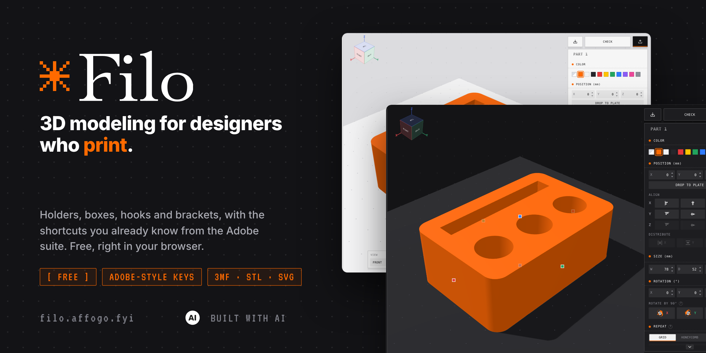
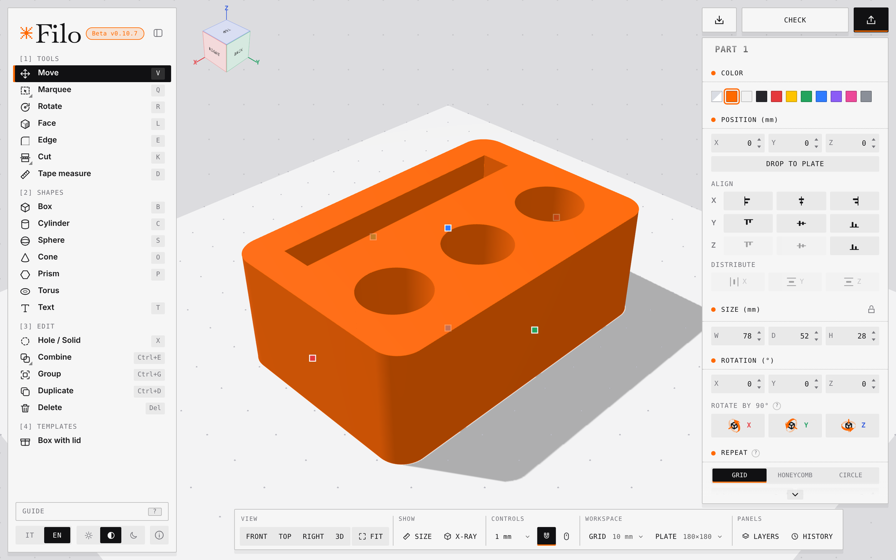
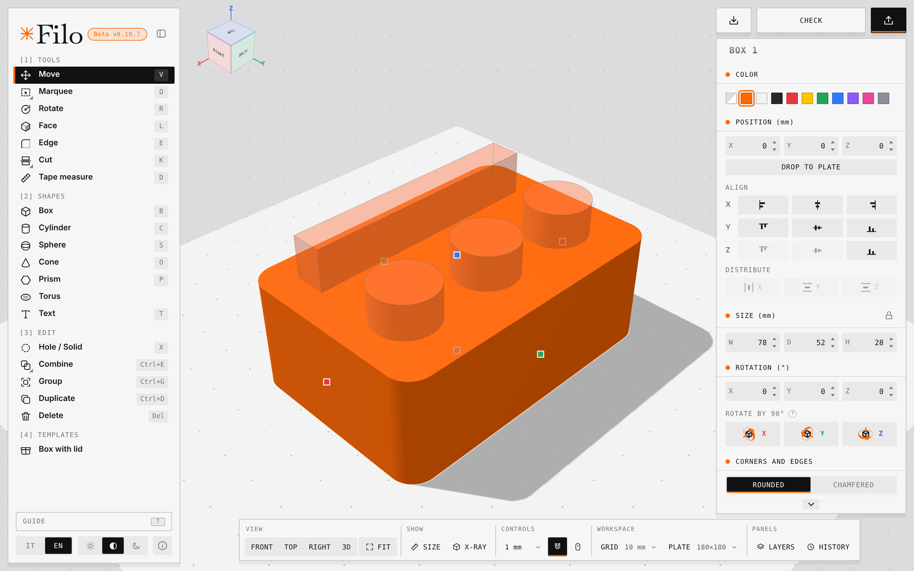
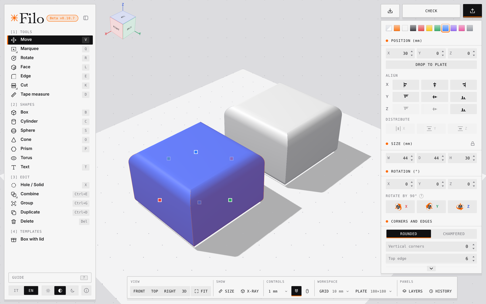
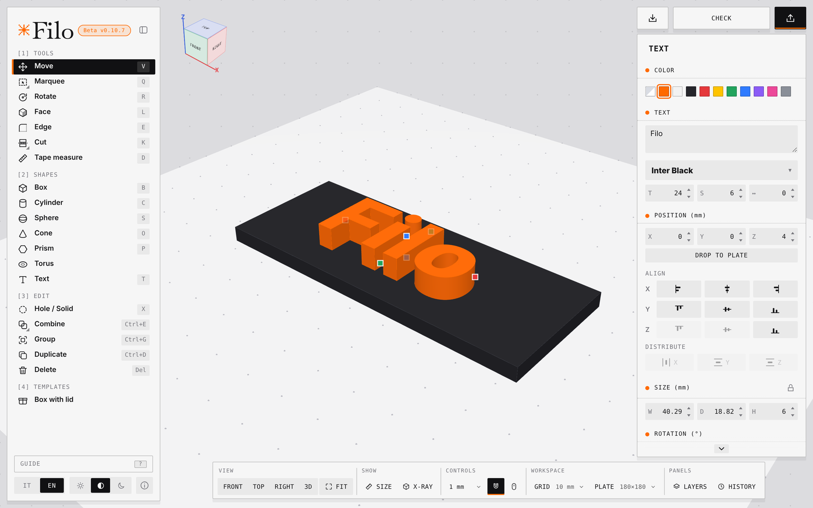
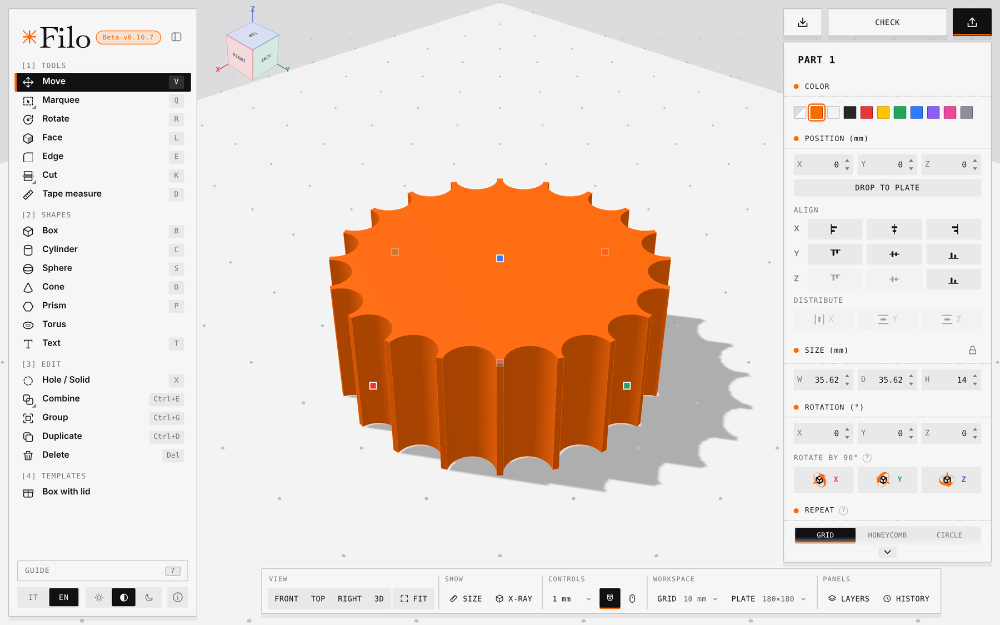
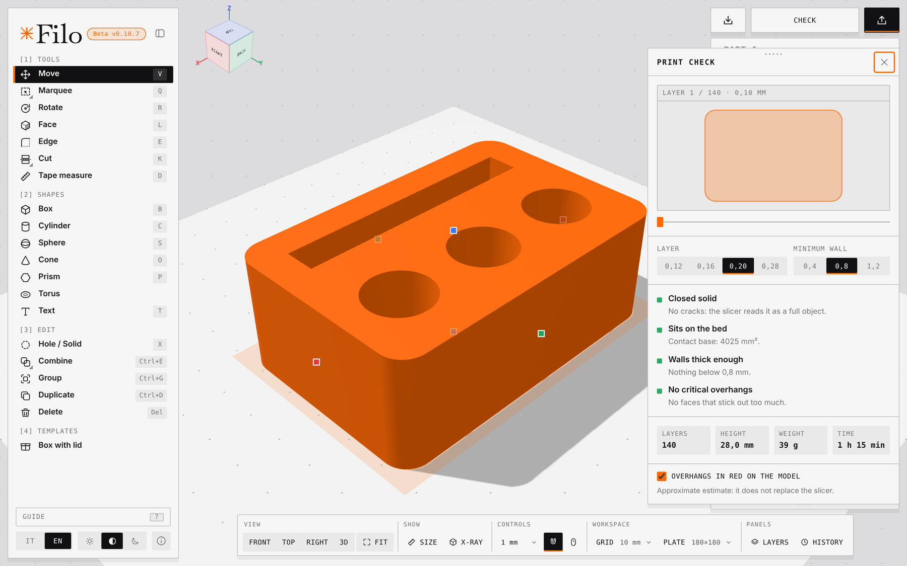
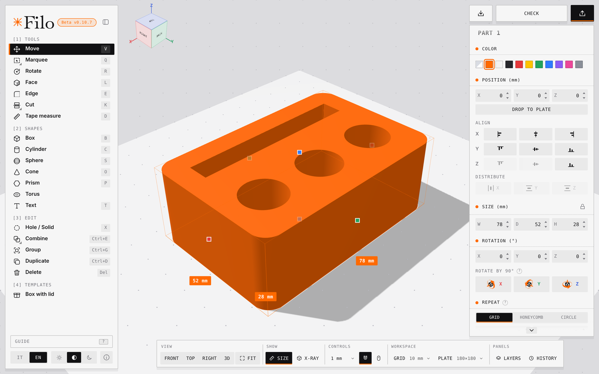
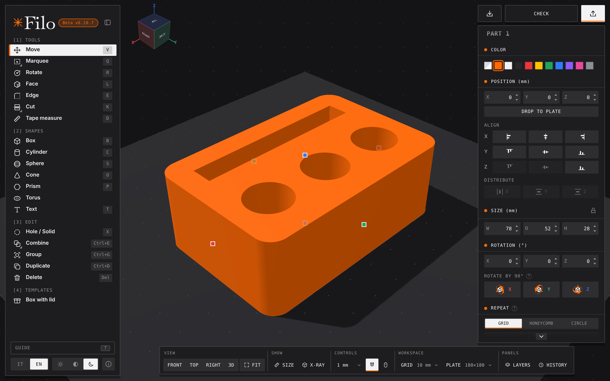
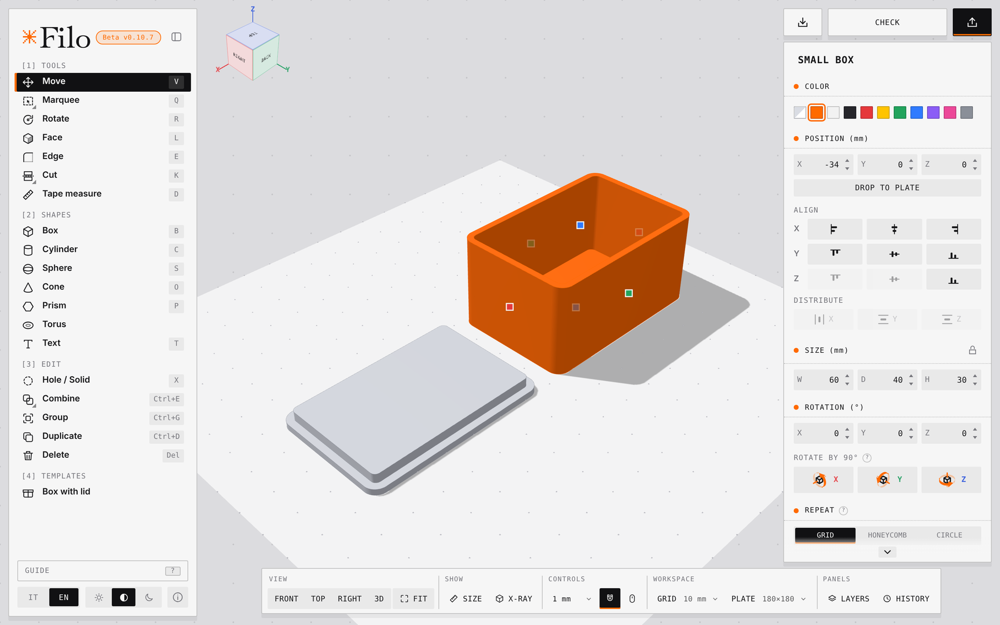

<div align="center">



<br>

**A tiny 3D modeler for things you're going to print: holders, boxes, hooks, brackets.**<br>
Shortcuts that feel like the Adobe suite. Free, right in your browser.

[**Open Filo → filo.affogo.fyi**](https://filo.affogo.fyi)


<picture>
  <source media="(prefers-color-scheme: dark)" srcset="docs/img/eu-ai-label-white.svg">
  
</picture>&nbsp; Built with AI assistance (Claude)

[English](README.md) · [Italiano](README.it.md)

</div>

---

## Why Filo

Filo is made for people who come from graphic design and want to print things without learning a full CAD package. If you've used Photoshop, Illustrator or similar tools, the keys will feel familiar: `V` to move, `T` for text, `R` to rotate, marquee and lasso on `Q` and `W`, layers, groups, history. Most of what gets printed is simple (a holder, a lid, a clip, a bracket), so Filo keeps to that: push shapes together, cut holes, round the edges, check the print and send it to the slicer.

**Filo doesn't aim to replace Fusion, Blender, FreeCAD or any other complex software.** It's a simple tool for small edits and simple models. If you need parametric sketches, assemblies or organic sculpting, use the right tool for that, and bring the result here for the quick fixes.

- **Open the site and start.** No account, nothing to install. Models stay on your device.
- **Familiar to designers.** Adobe-style shortcuts, layers, groups, history, light and dark theme.
- **Made for printing.** Bambu Lab plates, a print check, and a 3MF export that opens ready in Bambu Studio.
- **Always-closed solids.** Booleans run on Manifold, so combined parts come out watertight.

<p align="center">
  
</p>

## What it does

### Build

- Shapes: box, cylinder, sphere, cone, n-sided prism, torus, 3D text (any font, including your own) and SVG import
- "Box with lid" template, sized to your measurements, with preview
- Repeat in a grid, honeycomb or circle, with spacing between copies

<p align="center">
  
  
</p>

### Edit

- Move, rotate (15° snap), resize (also groups and rotated objects, with proportion lock), align and distribute
- **Face:** push or pull a flat face. **Edge:** round or chamfer, each edge with its own editable radius
- **Cut** with a plane, **Stretch** a part, **Tape measure** for widths, heights and angles under the cursor
- **Hole / Solid**, **Combine** (union, minus holes) and **Intersect**
- **Drop to plate** finds the nearest stable flat face and puts the part on Z = 0
- Groups, Layers (lock, hide, rename), History with previews, Undo / Redo
- Snap from 0.1 mm to free, with magnet to corners and edges of other objects

<p align="center">
  
  
</p>

### Check and print

- **Print check:** layer preview, thin walls, overhangs in red, floating parts, weight and time estimate
- Plates ready to go: A1 mini, A1, P1S, X1C, P2S, H2S, H2D, and custom sizes up to 40 cm
- Import 3MF (including from Bambu Studio and Orca), STL and SVG
- Export 3MF with Bambu Studio settings and automatic crack repair, or STL. Export always carries the whole plate

<p align="center">
  
  
</p>

### Interface

- Light, dark or automatic theme, X-ray view, true isometric and orthographic views
- Italian and English UI
- Built-in guide with images and GIFs (`?` or `F1`)

<p align="center">
  
  
</p>

## Shortcuts

`⌘` is `Ctrl` on Windows and Linux.

| Key | Action | Key | Action |
|---|---|---|---|
| `V` | Move | `B` `C` `S` `O` `P` | Box, cylinder, sphere, cone, prism |
| `Q` `W` | Marquee, Lasso | `T` | Text |
| `R` | Rotate | `X` | Hole / Solid |
| `L` | Face | `⌘E` `⇧⌘E` | Combine, Intersect |
| `E` | Edge | `⌘G` | Group |
| `U` `K` | Stretch, Cut | `⌘D` | Duplicate |
| `D` | Tape measure | `⌘Z` `⇧⌘Z` | Undo, Redo |
| `Tab` | Narrow sidebar | `F7` `F8` | Layers, History |

Everything else is in the in-app Guide.

## Use it

- **Online (recommended):** [filo.affogo.fyi](https://filo.affogo.fyi). Always the latest version.
- **Offline (optional):** Filo is a single file, so you can also download `index.html` from this repo and open it in your browser. No server or connection needed.

## Build from source

```bash
npm install
node build.mjs     # outputs dist/forma.html (about 3.3 MB, everything inlined)
```

| File | What's in it |
|---|---|
| `src/main.js` | Scene, tools, panels, import and export |
| `src/index.template.html`, `src/style.css` | Structure and style (the build inlines them) |
| `src/edges.js`, `src/mcsg.js`, `src/manifold.wasm.js` | Edges and booleans (Manifold, three-bvh-csg as fallback) |
| `src/textgen.js`, `src/print.js` | 3D text and print check |
| `src/i18n.js`, `src/help.js`, `src/helpimg.js` | IT/EN strings, Guide and its images |

Also in the repo: `DESIGN.md` (tokens, type, spacing and components, read it before touching the UI), `IDEE.md` (parked ideas, in Italian), `THIRD_PARTY_LICENSES.md` (generated by the build).

The tests in `tests/` are Playwright (Python) scripts that open `dist/forma.html` in headless Chromium and drive the app through `window.forma`. They point at `/tmp/forma/dist/forma.html`, so change the path if the project lives elsewhere.

**Stack:** three.js, Manifold, three-bvh-csg, clipper-lib, opentype.js, esbuild. Fonts: Inter, Bebas Neue, Lora, VT323.

## Built with AI

<picture>
  <source media="(prefers-color-scheme: dark)" srcset="docs/img/eu-ai-label-white.svg">
  
</picture>

Filo is designed and directed by me, and the code is written with the help of an AI assistant (Claude). I test it, print with it and decide what goes in. The screenshots and the banner in this README were also made with AI help. The icon is the [European Commission's icon for labelling AI-generated content](https://digital-strategy.ec.europa.eu/en/policies/eu-icons-labelling-ai-generated-content), used as published. It signals AI involvement and is not a statement of legal compliance.

<br clear="left">

## Status

Filo is out of beta since 1.0.0. It's still a one-person project, so expect some rough edges. Feedback is very welcome, from bugs to "this would help my prints" ideas. You can [open an issue](https://github.com/Affoghiamoci/Filo/issues) here, or comment on the Reddit post where I shared it.

## Privacy

The official site only counts visits anonymously, no cookies. Your models never leave your device, and the downloaded file sends nothing.

## License

Filo is **source-available** under the [PolyForm Noncommercial License 1.1.0](LICENSE). You can read the code, use Filo, modify it and share it for any non-commercial purpose (personal projects, hobby, study, research, non-profits). Using it commercially, for example reselling it, bundling it in a paid product or offering a modified version as a service, needs my permission: get in touch.

- **What you make is yours.** Models, 3MF/STL files and prints made with Filo belong to you, and you can print and sell them. The license covers the software, not your work.
- **Earlier versions.** Versions up to 0.10.7, published before this change, were released under the MIT license, and whoever received them keeps those terms.
- **Bundled libraries** keep their own open-source licenses (MIT, Apache-2.0, BSL-1.0, OFL-1.1); the texts are in [`THIRD_PARTY_LICENSES.md`](THIRD_PARTY_LICENSES.md).
